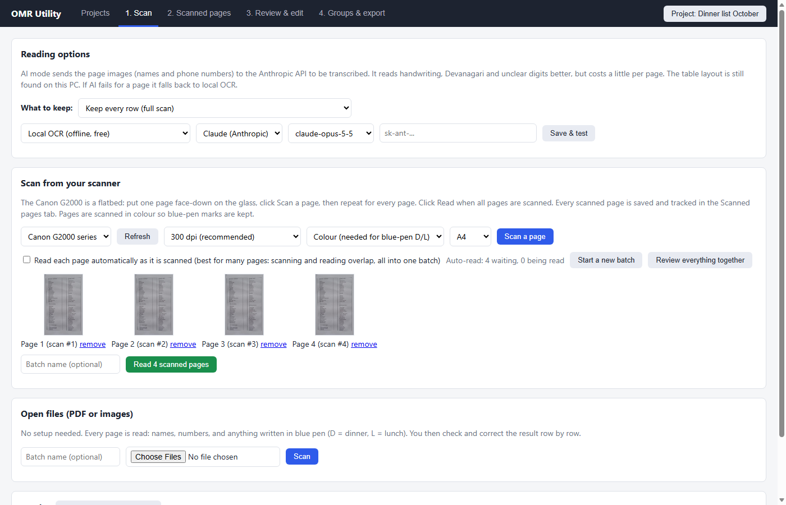
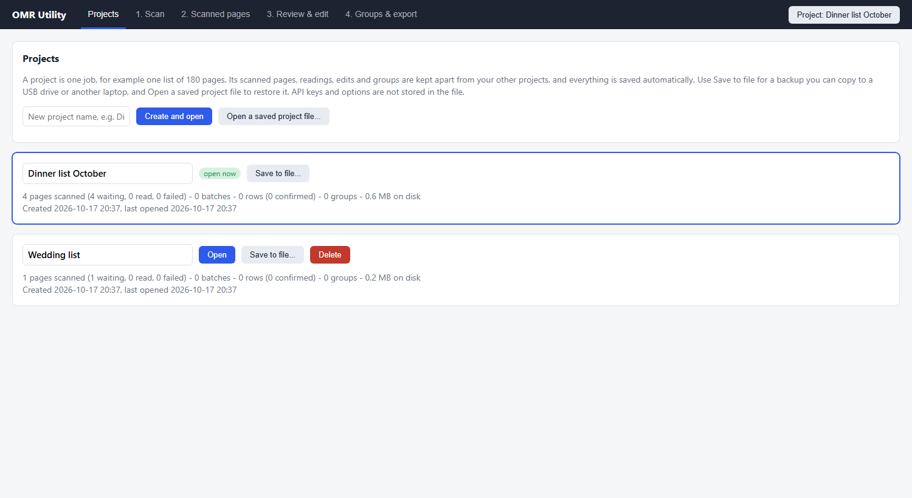

# OMR Utility

**Turn stacks of printed contact or guest lists into one clean, editable, sortable list.**

OMR Utility is a Windows desktop app. You scan pages (from a flatbed scanner), or open PDFs and photos, and it reads every row into an editable table: first name, middle name, last name, phone numbers and any pen marks. You check and correct the result, then sort the confirmed people into groups (for example *Dinner* and *Lunch*) and export them to CSV or Excel.

It was built for a specific job: a large printed contact list where someone has marked certain rows in blue pen with **D** (dinner), **L** (lunch) or a tick, and the organiser needs a clean list of just those people and their phone numbers. It works for any ruled-table list.

> **Status:** working and used end-to-end on real phone photos of contact sheets. The scanner connection and the cloud AI readers have been built and tested with stand-ins but not yet against real hardware / real API keys. See [Limitations](#limitations-read-this-first).

---

## Contents

- [Screenshots](#screenshots)
- [What it does](#what-it-does)
- [How it works in one minute](#how-it-works-in-one-minute)
- [Requirements](#requirements)
- [Install and run](#install-and-run)
- [Quick start](#quick-start)
- [The screens](#the-screens)
- [Reading engines: local vs AI](#reading-engines-local-vs-ai)
- [Dinner / lunch mode](#dinner--lunch-mode)
- [Projects and your data](#projects-and-your-data)
- [Accuracy: what to expect](#accuracy-what-to-expect)
- [Limitations (read this first)](#limitations-read-this-first)
- [Privacy and cost](#privacy-and-cost)
- [Troubleshooting](#troubleshooting)
- [Documentation](#documentation)
- [Project layout](#project-layout)
- [Contributing](#contributing)

---

## Screenshots

| Scan tab: scanner, reading options, open files | Projects tab |
|---|---|
|  |  |

## What it does

| Step | What happens |
|---|---|
| **Capture** | Scan pages one by one from a Windows scanner (WIA), or open PDFs and image files. Every scanned page is logged with a status. |
| **Read** | The app finds the table on each page, straightens it, works out the rows and columns, and reads each cell. Handwritten blue-pen **D**, **L** and tick marks are detected on their rows. |
| **Review** | Every row appears in an editable grid next to a picture of the original row. Doubtful readings are highlighted, duplicate phone numbers are flagged, and you can search, filter, bulk-edit and undo. |
| **Group** | Confirm the rows that are right, then add them to groups. One click creates *Dinner*, *Lunch* and *Ticked* groups from the pen marks. |
| **Export** | Export a group, or all groups, as CSV, a ZIP of CSVs, or an Excel workbook, with just the columns you choose. |

Also included:

- **Scanned-pages log**: every page you scan, with its status (*Scanned*, *Reading*, *Scraped*, *Failed*, *Discarded*) and the batch it went into.
- **Auto-read**: pages are read automatically as you scan them, so scanning and reading overlap.
- **Projects**: each job (for example "Dinner list October") is kept separate and can be saved to a single file and restored later or on another computer.
- **Cleaned phone numbers**: a tidy column splits messy contact cells (`97638 16612 ::: 9595815857 | …`), removes repeats, and writes mobile numbers as `+91…`. Your original text is kept next to it, unchanged.
- **Optional AI reading** with Claude (Anthropic) or Gemini (Google) for better accuracy on difficult pages.

## How it works in one minute

```
 scanner / PDF / photo
          │
          ▼
  find the table  →  straighten the page  →  find rows and columns
          │
          ▼
  read each cell (local OCR  or  AI vision)   +   detect blue-pen D / L / ✓
          │
          ▼
  editable review grid  →  confirm  →  groups  →  CSV / Excel
```

Your work is saved to disk continuously. Closing the app or switching the laptop off does not lose scanned or read pages. See [Projects and your data](#projects-and-your-data).

## Requirements

- **Windows 10 or 11** (the scanner connection uses Windows' scanner interface, WIA).
- **Microsoft Edge WebView2** runtime (already present on Windows 11 and most up-to-date Windows 10).
- For the optional **scanner** feature: a scanner with a Windows (WIA) driver. Developed for the Canon PIXMA G2000 flatbed.
- For the optional **AI** engines: an internet connection and an API key from Anthropic and/or Google.
- To run from source: **Python 3.12** and the packages in `requirements.txt`.

## Install and run

### Option A: the standalone app

Build it once (see below) and run `dist\OMR Utility\OMR Utility.exe`. No Python is needed to *run* it, and you can copy the whole `dist\OMR Utility` folder to another PC.

```
build.bat
```

### Option B: run from source

```
git clone https://github.com/imshailesh593/OMR_utility.git
cd OMR_utility
python -m venv .venv
.venv\Scripts\pip install -r requirements.txt
.venv\Scripts\python desktop.py      # opens the desktop window
```

You can also run it in a normal browser: `.venv\Scripts\python app.py`, then open <http://localhost:5000>. (A few desktop-only conveniences, such as the Save As dialog for exports, fall back to normal browser downloads.)

The first scan loads the OCR models, so it is slower than later ones.

## Quick start

1. **Create a project.** Open the **Projects** tab, type a name (for example *Dinner list October*) and click **Create and open**.
2. **Choose how to read.** On the **Scan** tab, under *Reading options*, leave it on *Local OCR* to start. Pick *Keep every row*, or *Dinner / lunch sheets* if you only need marked rows.
3. **Get pages in.**
   - *From a scanner:* switch it on, click **Refresh**, put a page face-down on the glass, click **Scan a page**, and repeat. Tick **Read each page automatically** to have pages read as you go.
   - *From files:* under *Open files*, click **Choose Files**, select your PDFs or images, and click **Scan**.
4. **Review.** Open **Review & edit**. Fix anything wrong (every cell is editable), then confirm rows. Use **Confirm all high-confidence** for the clearly right ones.
5. **Group.** Select rows and add them to a group, or click **Auto-group Dinner (D) / Lunch (L)**.
6. **Export.** Open **Groups & export**, tick the columns you want, choose CSV or Excel, and export.
7. **Back up.** On **Projects**, click **Save to file…** to keep a copy of the whole project.

A fuller walk-through is in [docs/USER_GUIDE.md](docs/USER_GUIDE.md).

## The screens

### Projects
Create, open, rename, delete, **Save to file…** (a `.omrproject` backup) and **Open a saved project file…**. Each project card shows its page, row and group counts and size on disk. The open project's name is always shown in the top-right corner.

### Scan
- **Reading options**: *What to keep* (every row, or only rows marked D / L / ✓), the reading engine (local or AI), the AI provider, model and key, and **Save & test**.
- **Scan from your scanner**: scanner, dpi (200, 300 recommended, 400, 600), colour or grey, paper size, **Scan a page**, thumbnails of pages waiting, **Read all scanned pages**, the **auto-read** switch, **Start a new batch** and **Review everything together**.
- **Open files**: choose PDFs or images and scan them in one go.
- **Batches**: every reading run, renamable, with confirmed counts.

### Scanned pages
A log of every page scanned from the scanner: preview, time, dpi, **status**, the batch it went into, rows found and notes. Filter by status; **Read the waiting pages now**; **Read again**, **Discard**, **Try again** or **Restore** individual pages. Nothing is ever removed from this list.

### Review & edit
One row per person, with a strip of the original page above each row's fields.

- Columns: **First name, Middle name, Last name, Contact (as read), Phones (cleaned), Meal (D/L), Other text, Full scanned row**.
- **Yellow** cells are low confidence. A **red outline / "dup"** means the same phone number is on another row (in any batch).
- Search any text; filter by *Pending, Confirmed, Low confidence, No phone number, Duplicate phone, No meal mark, Has meal mark, Not in a group*.
- Edit any cell at any time, even after confirming or grouping. Edits save when you leave the cell. **Undo** reverts your last 100 edits.
- **+** inserts an empty row below, **x** deletes a row, **Keep as data** rescues a row that was wrongly treated as a heading.
- Bulk actions on ticked rows: confirm, reopen, set the meal letter, delete, add to a group. **Select all N matching** covers every row that passes the filter.
- The grid shows 100 rows per screen, so a batch of thousands of rows stays fast. Use **All batches together** to review a whole job at once.

### Groups & export
Create and rename groups, see their members (editable), remove people, and export:

- **CSV**, a **ZIP** with one CSV per group, or an **Excel** workbook with one sheet per group.
- Choose any of the columns, and optionally the source file and page.
- Only **confirmed** rows that are **in a group** are exported (and *Export this batch* on the Review tab exports a batch's confirmed rows).

## Reading engines: local vs AI

| | Local OCR | AI vision (Claude or Gemini) |
|---|---|---|
| Cost | Free | Pay per page to the provider |
| Internet | Not needed | Needed |
| Privacy | Everything stays on your PC | Page images (names, phone numbers) are sent to the provider |
| Speed | ~20 to 30 s per page | Depends on provider; several requests per page |
| Accuracy | Good on phone numbers and clean print; weaker on handwriting, Devanagari/emoji and tricky letters | Expected to be much better, **not yet verified on real pages** |

In both modes the **table layout is found on your PC**. With AI, the page is cut into chunks of 14 rows, each labelled with row numbers, and the model returns the text of each cell. If an AI request fails for a page, that page is re-read with local OCR. If the key is rejected on the very first page, the scan stops with a clear message.

Setup: *Scan* tab → *Reading options* → pick the engine and provider, paste your key, **Save & test**. Keys are stored only on your PC. You can also use the `ANTHROPIC_API_KEY` or `GEMINI_API_KEY` environment variables.

## Dinner / lunch mode

Set *What to keep* to **Dinner / lunch sheets: keep ONLY rows marked D, L or with a check mark**. Every page is still read, but only rows that carry a pen mark are stored. A page with no marks finishes with 0 rows and a note.

Mark detection:

- Looks for **blue or dark-navy ballpoint** ink (so scan in **colour**).
- **D** is recognised by its straight stem and bowl, **L** by its stem and foot, and a **tick** (✓) by its short-then-long stroke.
- Crosses, circles and anything else are stored as `?` and highlighted so you can decide.
- **Auto-group** then creates *Dinner* (D), *Lunch* (L) and *Ticked (meal not specified)*.

## Projects and your data

Everything is saved automatically and continuously.

```
%APPDATA%\OMR Utility\
    settings.json            reading options and API keys (global, never exported)
    projects.json            the list of projects
    projects\<id>\
        omr2.db              the project's database (pages, rows, groups, scan log)
        images\              the straightened page images used by Review
        scans\               the original scanner images (and thumbs\)
```

- **Closing the app or a power cut:** scanned images and finished pages are already on disk. A page that was mid-read returns to the waiting queue, and you click **Read the waiting pages**. The only thing lost is a cell you were typing in and hadn't left yet.
- **Backups:** the app does not back up automatically. Use **Projects → Save to file…** to write a single `.omrproject` file (a zip of the database and images) and copy it somewhere safe. **Open a saved project file…** restores it as a new project. API keys are never included.
- Files you open through *Open files* are read, but the original PDFs are not copied into the project, so keep your own copies.

## Accuracy: what to expect

Measured on real phone photos of a contact sheet (compressed WhatsApp images, tilted, creased, with a blue colour cast):

- **Table structure** (rows, columns, number-only rows, serial/middle/last splits): correct.
- **Blue-pen D / L marks:** 3 of 3 read correctly.
- **Phone numbers:** mostly right; common errors are a `+` read as another character and merged duplicates (the cleaned column tidies most of these).
- **Names with the local reader:** roughly half exact and many more within a letter or two. This is the main weakness. Expect to correct names in Review.
- **Not readable locally:** emoji, Devanagari script and very faint text.

A flatbed scan or a phone's built-in document scanner (Notes / Files → *Scan Documents*) gives much cleaner input than a plain camera photo, and **photos sent through WhatsApp are compressed and read worse**. Send phone files by AirDrop, cable or iCloud instead.

## Limitations (read this first)

- **Windows only** for the scanner feature (WIA). The reading, review and export parts are plain Python/web code.
- **Scanner untested on hardware.** The Canon G2000 connection is written to the WIA standard and tested with a stand-in; it has not yet been run against the physical scanner. If WIA fails, use the Canon software to save JPEG/PDF and open those files here.
- **Flatbed means one page at a time.** There is no automatic sheet feeder or double-sided scanning on the G2000. For about 180 pages expect roughly 90 minutes of scanning by hand.
- **AI engines untested with real keys.** The integration is complete and the error handling was exercised against the real services with invalid keys, but real-page accuracy and cost are unmeasured.
- **Local name accuracy is limited** (see above).
- The reader expects **ruled tables** (or simple lists). Other layouts fall back to a plainer line-by-line reader, with weaker results.
- Single user, single computer, no login. Do not expose the local server to a network.
- No automated test suite yet.

## Privacy and cost

- **Local mode** never leaves your PC.
- **AI modes** upload page images, which contain names and phone numbers. Read your provider's data terms. On Google's free Gemini tier, content may be used to improve Google products, so use a billing-enabled key for personal data.
- **Estimated AI cost** (rough, not measured): a dense contact page is about 6,500 input and 10,000 output tokens, which at published list prices is roughly **$0.23 per page with Claude Opus 5.5, $0.12 with Sonnet 5.5 and under $0.01 with Haiku 5.5**. Gemini Flash is typically cheaper again. Test on three pages and check your provider's console before committing a large job.
- API keys are stored in `settings.json` in plain text on your PC. Keep your Windows account private.

## Troubleshooting

| Problem | What to try |
|---|---|
| *No scanner found* | Switch the scanner on, check USB, close Canon IJ Scan Utility or any other scanning program, click **Refresh**. If Windows doesn't list it under *Devices*, reinstall the Canon driver. |
| *Scanner is busy* | Another program has the scanner. Close it and retry. |
| *The API key was rejected* | Re-paste the key under **Save & test**. For Gemini, make sure the Generative Language API is enabled for that key. |
| A page shows **Failed** | Read the note on the *Scanned pages* tab. Use **Try again**. |
| Rows are missing or merged | The page may be skewed, folded or low resolution. Rescan flat in colour at 300 dpi, or use AI mode. |
| Names are wrong | Expected with local OCR. Correct them in Review, or try AI mode. |
| Phone numbers show as *dup* | The same number is on two rows (often a sheet that lists a contact twice). Check both. |
| Switching projects is disabled | Pages are being read. Wait for the progress to finish. |
| The app was closed while reading | Reopen it and click **Read the waiting pages** on the *Scanned pages* tab. |
| Where is my data? | `%APPDATA%\OMR Utility\`. |

## Documentation

- [docs/USER_GUIDE.md](docs/USER_GUIDE.md): step-by-step guide for people using the app, including a recommended workflow for a large job.
- [docs/TECHNICAL.md](docs/TECHNICAL.md): how the reader works, the data model, the HTTP API, and how to build and extend the app.

## Project layout

```
app.py              Flask server: projects, scanning jobs, review, groups, export
desktop.py          desktop window (pywebview) and Save As / Open dialogs
build.bat           builds the standalone app with PyInstaller
requirements.txt    Python dependencies
run.bat             starts the app in a browser from source
make_sample.py      generates a small sample list in sample/
omr/
    pages.py        loads PDFs/images, resizes pages
    table.py        table detection, straightening, grid, cell/strip OCR, phone cleaning
    scan.py         blue-ink mark detection (D / L / tick), line-reader fallback
    ai.py           Claude and Gemini vision readers
    scanner.py      Windows WIA scanner access
static/index.html   the whole user interface (one file, no build step)
docs/               user guide and technical notes
sample/             sample input
```

## Contributing

Issues and pull requests are welcome. Useful places to help: real-scanner testing, better handling of other table layouts, accuracy tests on more sheets, a proper test suite, and a Mac/Linux path that skips the scanner feature. See [docs/TECHNICAL.md](docs/TECHNICAL.md) first.

## Licence

No licence has been chosen yet; all rights reserved by the author until one is added.
